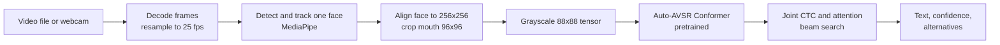

# LIP_READ

LIP_READ reads speech from lip movement alone, from an uploaded video or a live
webcam, and is meant for developers and researchers who want a working,
inspectable visual speech recognition pipeline rather than a notebook demo.

There is no audio anywhere in the system. Every transcript comes from a
*sequence* of mouth frames, so a single photo will never produce one.

> Transcripts are model predictions, not a record of what was said. On the
> benchmark this model was built for, roughly one word in five is wrong. Treat
> the confidence score as a way to rank guesses, not as a probability of being
> correct.

## What it does

- Transcribes an uploaded video clip (MP4, MOV, WebM, MKV, AVI) to English text.
- Transcribes live from a webcam in the browser, cutting the stream into
  utterances by watching the lips.
- Returns the best transcript, a confidence score and the next-best
  alternatives, or a plain reason when it cannot (no face, clip too short, model
  not loaded). It never fills a failure with plausible text.
- Shows a debug view of exactly what the model saw: face and mouth boxes, lip
  outline, buffer depth, latency, tensor shapes and a downloadable mouth video.

Nothing is trained in this repo. It runs the published, pretrained
[Auto-AVSR](https://github.com/mpc001/auto_avsr) visual-only model (250M
parameters, English) and the work here is everything around it: preprocessing
that matches the model's training contract, decoding, live streaming,
segmentation, an API, a web interface and the tests and evaluation that check
each of those.

## How it works



The web app (Next.js) talks to a FastAPI service over HTTP for uploads and a
WebSocket for live video. The service owns the model; the web app only knows
the shape of a result, not which model made it.

More detail:

- [docs/architecture.md](docs/architecture.md): components, live streaming,
  how speech is detected from lip shape, privacy, swapping the model
- [docs/preprocessing-spec.md](docs/preprocessing-spec.md): the exact input
  contract the model needs, and why none of it is adjustable
- [docs/api.md](docs/api.md): HTTP endpoints, the result object and the
  WebSocket protocol
- [docs/configuration.md](docs/configuration.md): every environment variable
- [docs/evaluation.md](docs/evaluation.md): how accuracy is measured and how to
  reproduce it
- [FAILURES.md](FAILURES.md): what can go wrong, what went wrong, how it was
  fixed, and results

## Results

Word error rate (WER) on LRS3 test utterances, measured with
`scripts/evaluate_lrs3.py`:

| Input | WER | What it tells you |
| --- | --- | --- |
| Reference mouth crops fed straight to the model | 5.7% (2/35 words) | The model, vocabulary and decoder are wired up correctly |
| Full pipeline on composite video clips | 25.7% (9/35 words) | The cost of this project's own detection, alignment and cropping |
| Published Auto-AVSR, full LRS3 test set | 20.3% | Upstream reference figure, not measured here |

Both measured rows use only **five utterances**, so they show the pipeline
works end to end; they are not a benchmark result. Accuracy on real webcam
footage, other languages, or other speakers has not been measured yet. See
[docs/evaluation.md](docs/evaluation.md) for how to rerun these numbers.

## Quick start

You need:

- **Python 3.10, 3.11 or 3.12.** Not 3.13: the pinned MediaPipe 0.10.14 has no
  wheels for it (see the comment in `requirements.txt`).
- **Node 20+** for the web interface.
- **About 1 GB of disk** for the model weights.
- **Git**, to fetch the upstream Auto-AVSR code this project builds on.

A CUDA GPU is used when present; the CPU works too, just more slowly. FFmpeg is
not needed because PyAV bundles it.

### 1. Python environment

Linux or macOS:

```bash
python3.11 -m venv .venv
source .venv/bin/activate
pip install torch torchvision torchaudio --index-url https://download.pytorch.org/whl/cpu
pip install -r requirements-dev.txt
```

Swap `whl/cpu` for `whl/cu124` if you have an NVIDIA GPU with CUDA 12.4.
PyTorch is installed on its own first because the right wheel depends on your
CUDA setup.

Windows (PowerShell) has a script that does the same:

```powershell
.\scripts\setup_env.ps1          # add -Cpu for a CPU-only PyTorch build
```

### 2. Reference code and model weights

The model code, the mean face used for alignment and the SentencePiece
vocabulary come from the upstream Auto-AVSR repository. They are read from
`references/auto_avsr`, which is not committed, so clone it there:

```bash
git clone --depth 1 https://github.com/mpc001/auto_avsr.git references/auto_avsr
python scripts/download_checkpoint.py   # about 1 GB, hash checked before use
python scripts/check_env.py             # reports anything still missing
```

The weights come from a Hugging Face mirror of the upstream checkpoint. The
upstream code is Apache 2.0; the weights carry the terms of the datasets they
were trained on and are intended for research use.

### 3. Run it

Two processes. The backend loads the model once at start-up.

```bash
# terminal 1: ML backend on http://127.0.0.1:8000
cd services/ml-api
../../.venv/bin/python -m uvicorn app.main:app --port 8000

# terminal 2: web interface on http://localhost:3000
cd apps/web
npm install
npm run dev
```

On Windows, the backend's Python is `..\..\.venv\Scripts\python.exe`.

Open http://localhost:3000, allow the camera or upload a clip. Press
**Shift+D**, or use the control at the bottom of the page, for the debug view.

If the backend runs somewhere other than `http://127.0.0.1:8000`, create
`apps/web/.env.local` with `NEXT_PUBLIC_ML_API_URL=<backend url>`, and add the
web app's origin to `VSR_API_CORS_ORIGINS` on the backend.

## Usage without the interface

From the repo root, with the virtual environment active:

```bash
# transcribe a file
python scripts/transcribe.py path/to/clip.mp4

# also write MP4s of exactly what the model saw (into debug_out/)
python scripts/transcribe.py path/to/clip.mp4 --debug

# check face and mouth framing only, no model needed
python scripts/transcribe.py path/to/clip.mp4 --preprocess-only --debug --overlay

# print the full result object as JSON
python scripts/transcribe.py path/to/clip.mp4 --json
```

Or call the API directly once the backend is running:

```bash
curl -F "file=@clip.mp4;type=video/mp4" http://127.0.0.1:8000/v1/transcribe
```

which returns, for example:

```json
{
  "text": "I WOULD LOVE TO HEAR FROM YOU",
  "confidence": 0.792,
  "alternatives": [{ "text": "I WOULD LOVE TO GET IT FROM YOU", "confidence": 0.6527 }],
  "processing_ms": 779,
  "frames_processed": 34,
  "mouth_detected": true,
  "error": null
}
```

That output is from one of the composite test clips on a CPU. The full API,
including the live WebSocket, is in [docs/api.md](docs/api.md).

## Project structure

```
apps/web            Next.js interface: camera, upload, transcript, debug view
services/ml-api     FastAPI service: upload inference and the live WebSocket
ml/
  preprocessing     decode, detect, track, align, crop, build the tensor
  models            model adapters (Auto-AVSR works; VALLR, AV-HuBERT, custom are stubs)
  decoding          SentencePiece vocabulary and beam search
  inference         the engine joining preprocessing, model and decoding
  streaming         rolling buffer, utterance segmentation, inference queue
  evaluation        word and character error rate
scripts             setup, download, transcribe, evaluate, test fixtures
tests               pytest suite (158 tests, no model weights needed)
docs                architecture, API, configuration, evaluation, preprocessing spec
references          upstream Auto-AVSR checkout, cloned locally, not committed
checkpoints         downloaded weights, not committed
data                generated test clips and LRS3 samples, not committed
```

## Tests

```bash
python -m pytest                          # 158 tests
cd apps/web && npx eslint . && npm run build
```

The Python tests need the `references/auto_avsr` checkout from step 2 but not
the model weights. Without the checkout, the alignment, pipeline and API tests
fail on the missing mean face file. Test videos are generated on the fly from
scikit-image's public-domain sample portrait, so no real person's face is
committed.

There is no CI yet, so run these before you push.

## Limitations

- **English only, one speaker.** The checkpoint is an English model, and the
  tracker follows a single face.
- **Accuracy is modest and lightly measured.** Five utterances is a smoke
  test, not a benchmark. Expect wrong words, especially on short phrases.
- **Confidence is not calibrated.** It ranks hypotheses; it is not "chance this
  is right".
- **Preprocessing costs accuracy.** On the composite clips, the full pipeline
  is about 20 points of WER worse than the reference crops. Some of that is the
  composite clips themselves, which read harder than real video.
- **Live mode can be fooled.** A fast head movement can open an utterance (it
  is then dropped rather than transcribed), and when the face mesh fails on a
  frame the segmenter goes blind for that frame.
- **Setup has a manual step.** The upstream Auto-AVSR checkout has to be cloned
  by hand. Error messages in the code mention `scripts/fetch_references.py`,
  which is not in the repo yet; use the `git clone` command above instead.
- **VALLR, AV-HuBERT and custom adapters are interface stubs** that raise an
  error on purpose. Only Auto-AVSR runs.
- **Research-use weights.** Check the dataset terms before using the
  checkpoint in anything commercial.

## Roadmap

- Add `scripts/fetch_references.py` so setup is one command, matching the
  error messages.
- Add CI that runs the Python tests and the web lint and build on every push.
- Evaluate on a larger LRS3 sample and on a few consented real webcam
  recordings, and publish those numbers next to the current ones.
- A Linux and macOS setup script alongside `setup_env.ps1`.
- A working second adapter (VALLR) to show the model swap in practice.

## Credits

Studied, not copied: [mpc001/auto_avsr](https://github.com/mpc001/auto_avsr)
for preprocessing and the model, [MarshallT-99/VALLR](https://github.com/MarshallT-99/VALLR)
for MediaPipe face handling and its phoneme decoding design, and
[facebookresearch/av_hubert](https://github.com/facebookresearch/av_hubert) as
research background.

## Licence

The code in this repository is under the [MIT License](LICENSE). The
Auto-AVSR code it loads from `references/` is Apache 2.0, and the pretrained
weights follow the terms of their training datasets (research use).

Made by Tehilla Obanor. More work at https://cv.omnitest.dev/
