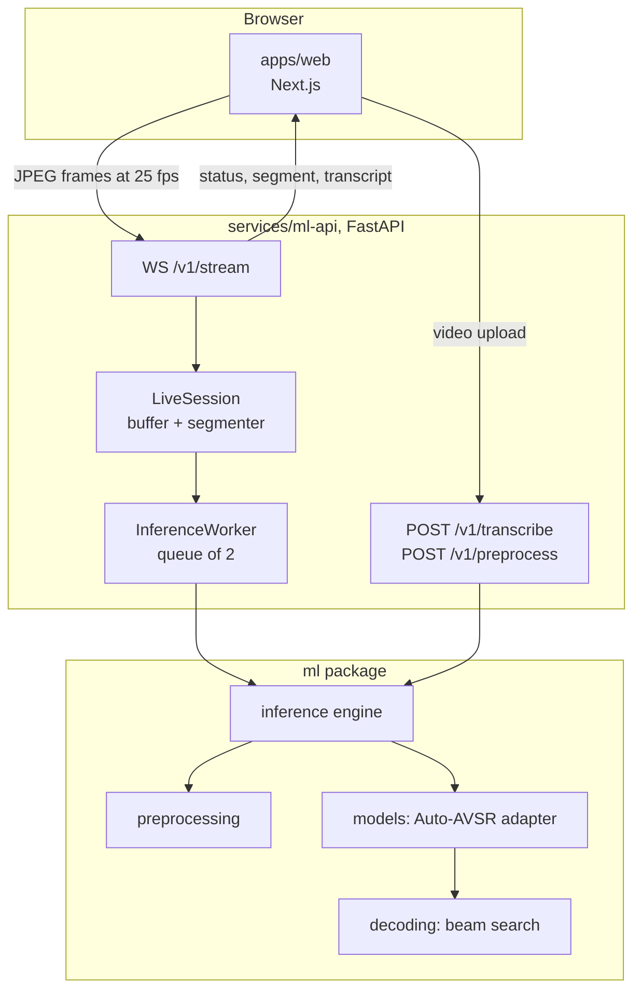

# Architecture

How the pieces fit together, and the reasoning behind the parts that are not
obvious. For the exact numbers the model needs (frame rate, crop sizes,
normalisation), see [preprocessing-spec.md](preprocessing-spec.md).

## Components



| Folder | Job |
| --- | --- |
| `apps/web` | Camera capture, upload, transcript list, debug panel. Knows only the result shape. |
| `services/ml-api` | Loads the model once at start-up, serves uploads and the live WebSocket. |
| `ml/preprocessing` | Decode, resample, detect and track a face, align, crop the mouth, build the tensor. |
| `ml/models` | `VisualSpeechModel` interface, the Auto-AVSR adapter, stubs, checkpoint download and checks. |
| `ml/decoding` | SentencePiece vocabulary and joint CTC and attention beam search. |
| `ml/inference` | `InferenceEngine`, which joins preprocessing, model and decoding and turns failures into results with an `error` field. |
| `ml/streaming` | Rolling frame buffer, lip-motion utterance segmenter, inference worker queue. |
| `ml/evaluation` | Word and character error rate. |

UI code and model code never mix. The web app has no idea which model produced
a result.

## The model

The only working adapter runs the pretrained Auto-AVSR visual-only model:

```
(1, T, 1, 88, 88)  network input
      -> Conv3dResNet front-end   -> (1, T, 512)
      -> proj_encoder (Linear)    -> (1, T, 768)
      -> Conformer encoder x12    -> (1, T, 768)
      -> CTC head                 -> (1, T, 5049)
      -> Transformer decoder x6   -> tokens
```

About 250M parameters, trained upstream on LRW, LRS2, LRS3, VoxCeleb2 and
AVSpeech (3,291 hours). Nothing is trained or fine-tuned in this repo. The
network code is imported from the `references/auto_avsr` checkout, and
`ml/models/auto_avsr/loader.py` renames the checkpoint's parameter names to
match it, refusing to load if any weight is left over. Details are in the
preprocessing spec.

If the checkpoint is missing, inference fails with instructions. It never
falls back to an untrained network, which would produce fluent nonsense.

## Live streaming

The browser sends JPEG frames over the WebSocket at the model's frame rate
(25 fps, not the display's). The receive loop only decodes, detects and
buffers; finished utterances go to a worker thread.

The queue holds two segments. A third arrival pushes out the oldest rather than
growing the backlog: on a live stream a queued segment is already stale by the
time it would be transcribed, and each one pushes the next result further
behind. When that happens the client is told (`displaced_earlier_segment`), so
nothing disappears silently.

## Deciding when someone is speaking

Running the model all the time is wasteful and produces nonsense between
utterances, so the stream is cut into segments by watching the lips.

The obvious signal, how much the pixels around the mouth change between
frames, does not work. On this project's test fixtures, moving your head with
your mouth shut scores *higher* than talking, because moving a face across a
background changes far more pixels than a jaw does:

| Signal, per frame at 25 fps | Still | Head moving, mouth shut | Speaking |
| --- | --- | --- | --- |
| Frame difference around the mouth | 0.000 | 0.079 | 0.023 |
| Change in lip aperture | 0.0003 | 0.004 | 0.008 to 0.08 |

The segmenter uses the second row: the gap between the inner lips from a
MediaPipe FaceMesh fit, divided by the distance between the eyes. Dividing by a
facial distance turns it into a *shape* rather than a size, so it ignores where
the head is, how far away it is and how it is tilted. Head motion then reads an
order of magnitude below speech instead of above it.

The thresholds were not picked by hand. `scripts/tune_motion_thresholds.py`
sweeps them against the labelled fixtures and reports which settings catch
every speech clip while firing on none of the still or head-moving clips; the
defaults sit in the middle of that range. Hysteresis and a short hangover keep
an utterance open through the brief closures inside normal speech, and every
utterance is clamped between `VSR_MIN_UTTERANCE_SECONDS` and
`VSR_MAX_UTTERANCE_SECONDS`.

This costs a second MediaPipe graph per frame. Measured end to end, `observe()`
takes about 22 ms per 640x480 frame on CPU, a ceiling of about 45 fps against
a 25 fps target, so it is affordable without skipping frames.

Two known limits:

- A fast head movement can still open an utterance. If the motion does not
  continue, the utterance is dropped without being transcribed, so the cost is
  a wasted inference rather than an invented transcript.
- When the mesh fails on a frame that the face detector handles, segmentation
  is blind for that frame while the mouth indicator stays lit. The debug view
  shows the mesh state separately for exactly this reason.

## Privacy

Nothing a user sends is kept by default.

- Uploads are streamed to a temp directory and deleted in a `finally` block
  once inference returns. Anything left behind by a crash is swept at start-up
  and on a timer.
- Camera frames are only held in a few seconds of rolling buffer in memory.
- Debug MP4s are opt-in per request and expire with the same sweep.

Keeping uploads has to be switched on: `VSR_PERSIST_UPLOADS=1`.

## Swapping the model

Implement `VisualSpeechModel` from `ml/models/base.py` (`spec`, `load`,
`preprocess`, `infer`, `decode`) and register it:

```python
from ml.models import register_model

register_model("my_model", MyAdapter)
```

Then set `VSR_MODEL=my_model`. Nothing outside `ml/models` needs to change.
`ml/models/custom.py` is a template. `VALLRAdapter` and `AVHubertAdapter` are
interface stubs that raise rather than pretend to work; AV-HuBERT in
particular needs an old Fairseq environment that this project deliberately
avoids.
